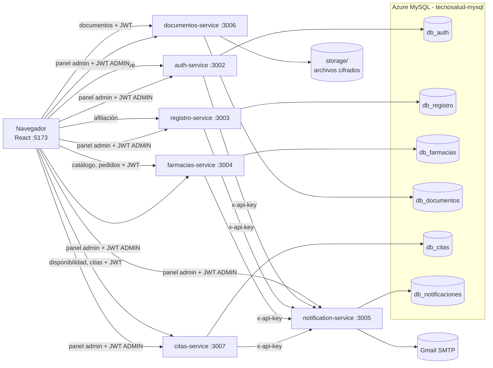
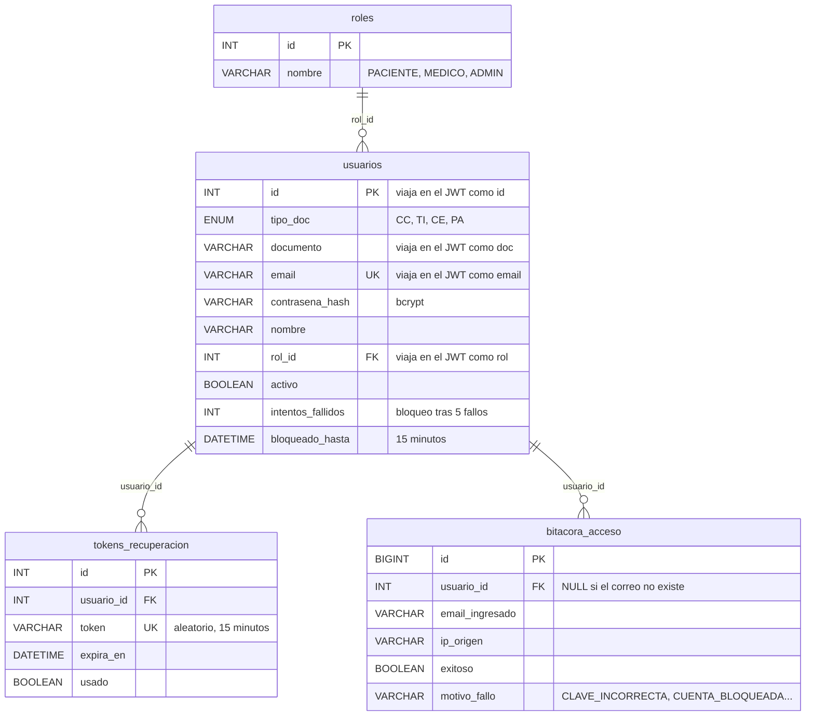
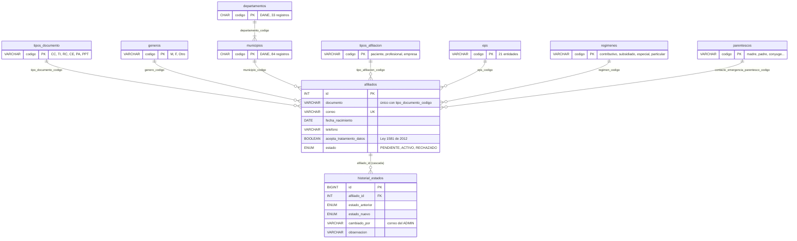
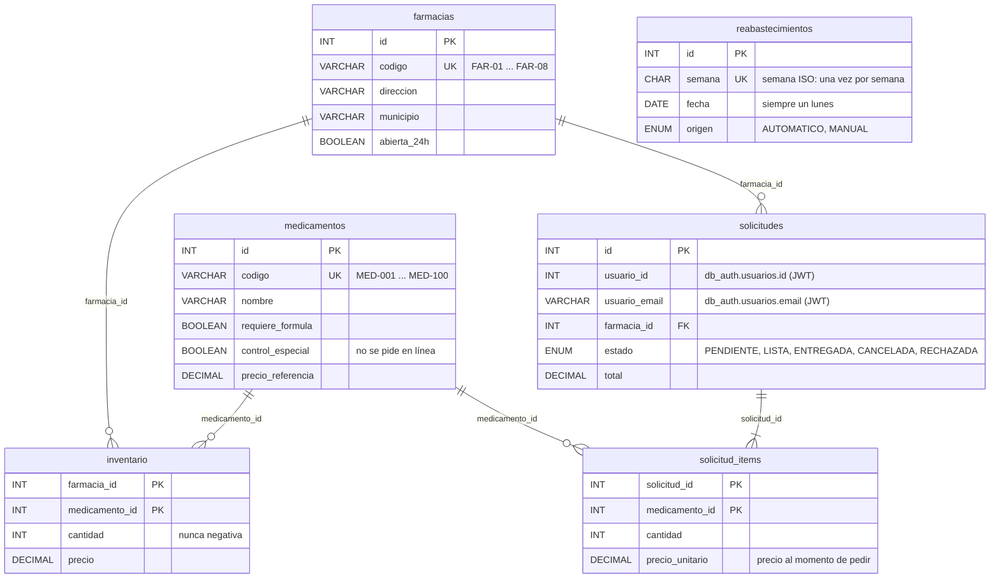
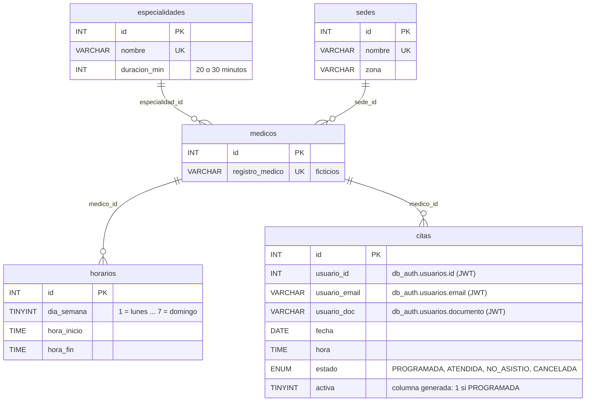
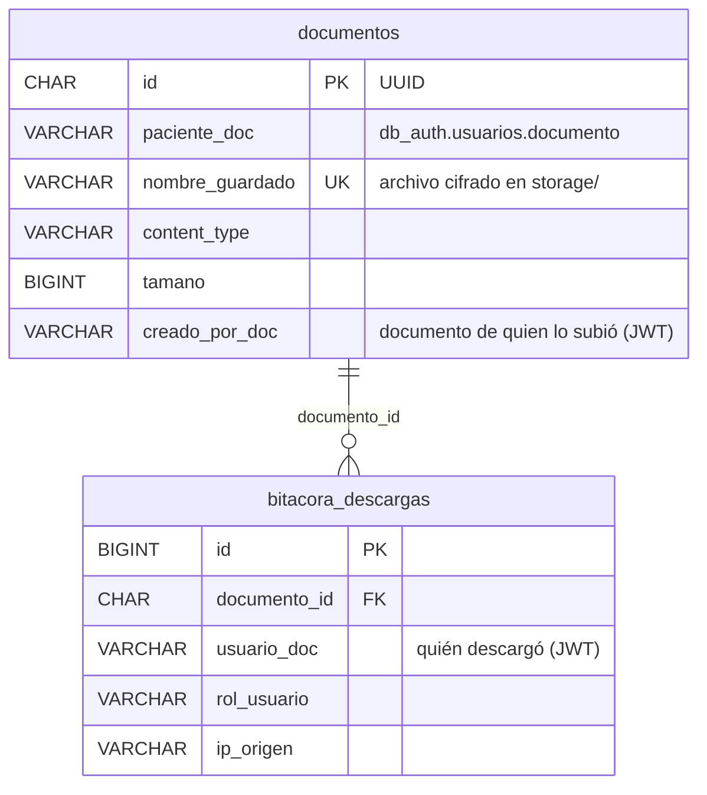
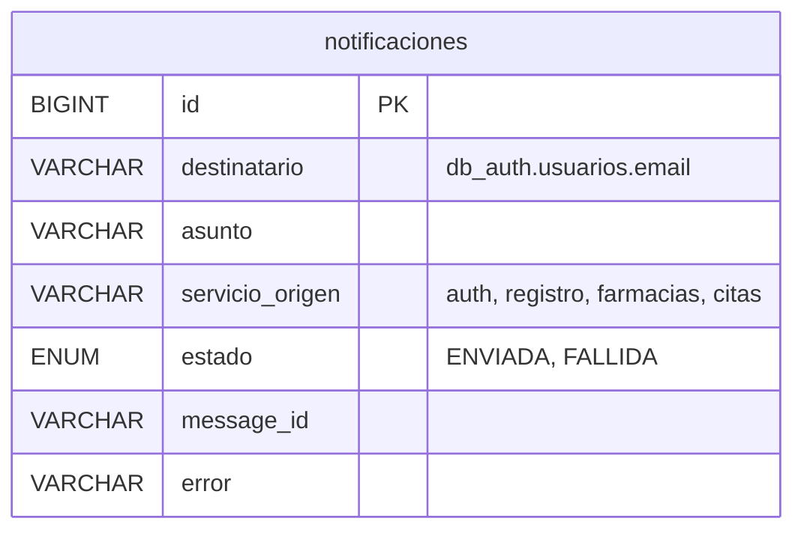

# Arquitectura de datos de Tecnosalud Católica

Este documento explica **qué guarda cada microservicio, en qué base de datos y cómo se relacionan los datos entre servicios**. Todas las bases viven en el mismo servidor de **Azure Database for MySQL** (`tecnosalud-mysql.mysql.database.azure.com`, región Mexico Central, MySQL 8.4, conexión con SSL). Se crean o actualizan con un solo comando:

```bash
cd backend
npm run db:init                 # las seis bases
npm run db:init -- registro     # solo una: auth, registro, farmacias, documentos, notificaciones o citas
```

El comando se puede repetir sin perder datos: usa `CREATE TABLE IF NOT EXISTS`, `INSERT … ON DUPLICATE KEY UPDATE` e `INSERT IGNORE`. Para verlas en Azure: servidor `tecnosalud-mysql` → **Settings → Databases**.

---

## 1. Principio: una base de datos por microservicio, en el mismo servidor

Cada microservicio es **dueño exclusivo** de su base de datos dentro del servidor de Azure. Ningún servicio lee ni escribe en la base de otro.

| Microservicio | Puerto | Base de datos | Tablas | Qué guarda |
|---|---|---|---|---|
| `auth-service` | 3002 | `db_auth` | 4 | Usuarios, roles, contraseñas (bcrypt), tokens de recuperación, bitácora de accesos |
| `registro-service` | 3003 | `db_registro` | 10 | Catálogos colombianos y solicitudes de afiliación con su historial |
| `farmacias-service` | 3004 | `db_farmacias` | 6 | Medicamentos, farmacias, inventario, pedidos y reabastecimientos |
| `notification-service` | 3005 | `db_notificaciones` | 1 | Historial de correos enviados |
| `documentos-service` | 3006 | `db_documentos` | 2 | Metadatos de documentos clínicos y bitácora de descargas (archivos cifrados en disco) |
| `citas-service` | 3007 | `db_citas` | 5 | Especialidades, sedes, médicos, horarios y citas |

**¿Por qué así y no una sola base?** Si un servicio cambia sus tablas, se cae o se reemplaza, los demás siguen funcionando. Es el patrón *database per service* de las arquitecturas de microservicios. **Dentro de cada base sí hay llaves foráneas** (por ejemplo, `afiliados → municipios`). **Entre bases distintas no las hay**: esas relaciones se hacen con identificadores que viajan en el JWT o en las llamadas entre servicios (sección 3).



---

## 2. Tablas de cada base de datos

### 2.1 `db_auth` (auth-service)



Usuarios nuevos: `npm run usuario:crear` (README). El administrador activa, desactiva y desbloquea cuentas desde el panel.

### 2.2 `db_registro` (registro-service) — catálogos colombianos



- **Llaves foráneas a todos los catálogos:** MySQL rechaza un municipio, EPS o tipo de documento que no exista (verificado en Azure con el error `ER_NO_REFERENCED_ROW_2`).
- **Reglas colombianas en el servicio:** el tipo de documento según la edad (CC desde 18 años, TI de 7 a 17, RC menores de 7) y teléfono celular de 10 dígitos que empieza por 3 o fijo 60 + 8 dígitos.
- **Formulario:** la lista de municipios depende del departamento elegido.

### 2.3 `db_farmacias` (farmacias-service)



Ciclo de un pedido: el **usuario** lo crea (PENDIENTE) o lo cancela. El **ADMIN** lo marca LISTA y luego ENTREGADA, o lo RECHAZA. Al cancelar o rechazar, las unidades vuelven al inventario. Los lunes, los productos con menos de 60 unidades vuelven a 60.

### 2.4 `db_citas` (citas-service)



- **Disponibilidad:** se calcula con los horarios menos las citas programadas, en hora de Bogotá; no se guarda.
- **Doble reserva:** el índice único `(medico_id, fecha, hora, activa)` impide reservar dos veces el mismo horario aunque dos personas lo intenten al mismo tiempo (verificado en Azure). Al cancelar, `activa` pasa a NULL y el horario se libera.

### 2.5 `db_documentos` (documentos-service)



Los archivos están en `backend/services/documentos-service/storage/`, cifrados con AES-256-GCM (`DOCUMENTOS_ENCRYPTION_KEY`).

### 2.6 `db_notificaciones` (notification-service)



No guarda el cuerpo del correo, para no almacenar enlaces de recuperación ni datos clínicos.

---

## 3. Cómo se relacionan los datos entre servicios

Al iniciar sesión, `auth-service` firma un **JWT** con `{ id, email, doc, rol }`. Los demás servicios **validan la firma** con el mismo `JWT_SECRET` y usan esos datos como identidad, sin consultar `db_auth`:

| Dato en otra base | Se relaciona con `db_auth.usuarios` por | Cómo llega |
|---|---|---|
| `db_farmacias.solicitudes.usuario_id` / `usuario_email` | `usuarios.id` / `email` | Campos `id` y `email` del JWT al pedir |
| `db_citas.citas.usuario_id` / `usuario_email` / `usuario_doc` | `usuarios.id` / `email` / `documento` | JWT al reservar |
| `db_documentos.documentos.paciente_doc`, `creado_por_doc`, `bitacora_descargas.usuario_doc` | `usuarios.documento` | Campo `doc` del JWT |
| `db_registro.historial_estados.cambiado_por` | `usuarios.email` del ADMIN | JWT del administrador |
| `db_notificaciones.notificaciones.destinatario` | `usuarios.email` | El servicio que pide el correo |
| `db_registro.afiliados.documento` y `correo` | `usuarios.documento` y `email` | Al aprobar la afiliación se crea la cuenta con los mismos datos (`npm run usuario:crear`) |
| Permisos (`MEDICO`, `ADMIN`) | `roles.nombre` | Campo `rol` del JWT; las rutas `/admin` exigen `ADMIN` |

**Consecuencias de diseño:**
- Los pedidos y las citas guardan el correo con el que se hicieron: si el usuario lo cambia después, el historial conserva el original.
- El JWT vale 8 horas. Si un administrador desactiva una cuenta, el usuario no podrá volver a iniciar sesión, pero el token vigente sigue sirviendo hasta que expire.
- Para cruzar datos de varias bases (como hace el panel de administración), se consulta el endpoint de cada servicio. Nunca se hace un `JOIN` entre bases.

---

## 4. Flujos completos

1. **Iniciar sesión:** `auth-service` valida en `db_auth`, registra el intento en `bitacora_acceso`, actualiza el bloqueo, pide la alerta por correo y entrega el JWT.
2. **Afiliarse:** el formulario carga los catálogos de `db_registro`. `registro-service` valida contra ellos, guarda en `afiliados` (estado PENDIENTE) y envía la confirmación. El ADMIN la aprueba o rechaza, y el cambio queda en `historial_estados`.
3. **Agendar una cita:** `citas-service` calcula los horarios libres, valida la franja, inserta en `citas` (el índice único evita la doble reserva) y envía la confirmación.
4. **Pedir medicamentos:** `farmacias-service` valida la fórmula, bloquea el inventario, descuenta, crea `solicitudes` + `solicitud_items` y envía la confirmación. El ADMIN lo despacha (LISTA y luego ENTREGADA) y el usuario recibe un correo.
5. **Documentos:** `documentos-service` cifra el archivo, guarda los metadatos y registra cada descarga.
6. **Panel de administración:** el navegador llama a `/admin/resumen` de los seis servicios con el JWT del ADMIN (ver `docs/PANEL_ADMIN.md`).

---

## 5. Seguridad de los datos

- **Conexión:** cifrada con Azure (`DB_SSL=true`, TLS 1.2) y firewall por IP.
- **Cifrado:** contraseñas con bcrypt, documentos con AES-256-GCM y correos sin cuerpo en el historial.
- **Consultas:** parametrizadas (`?`) en todos los servicios, para evitar inyección SQL.
- **Credenciales:** solo en los `.env` de cada servicio, que nunca se suben a git (ver los `.env.example`).
- **Auditoría:** `bitacora_acceso` (logins), `historial_estados` (afiliaciones), `bitacora_descargas` (documentos), `notificaciones` (correos) y `reabastecimientos` (inventario).
