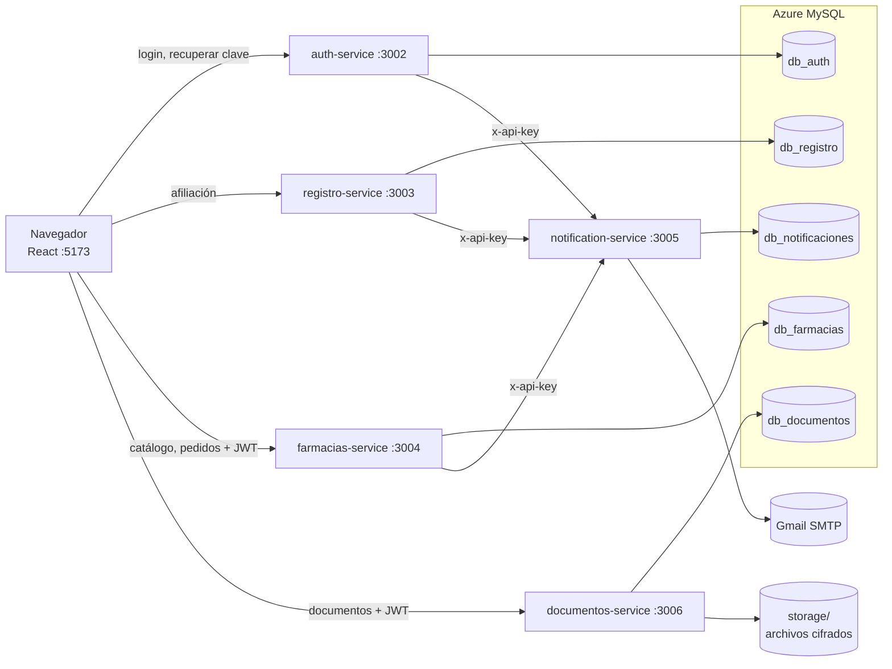
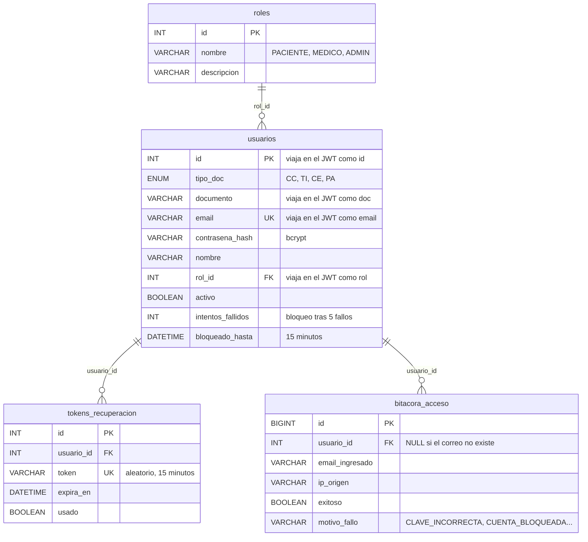
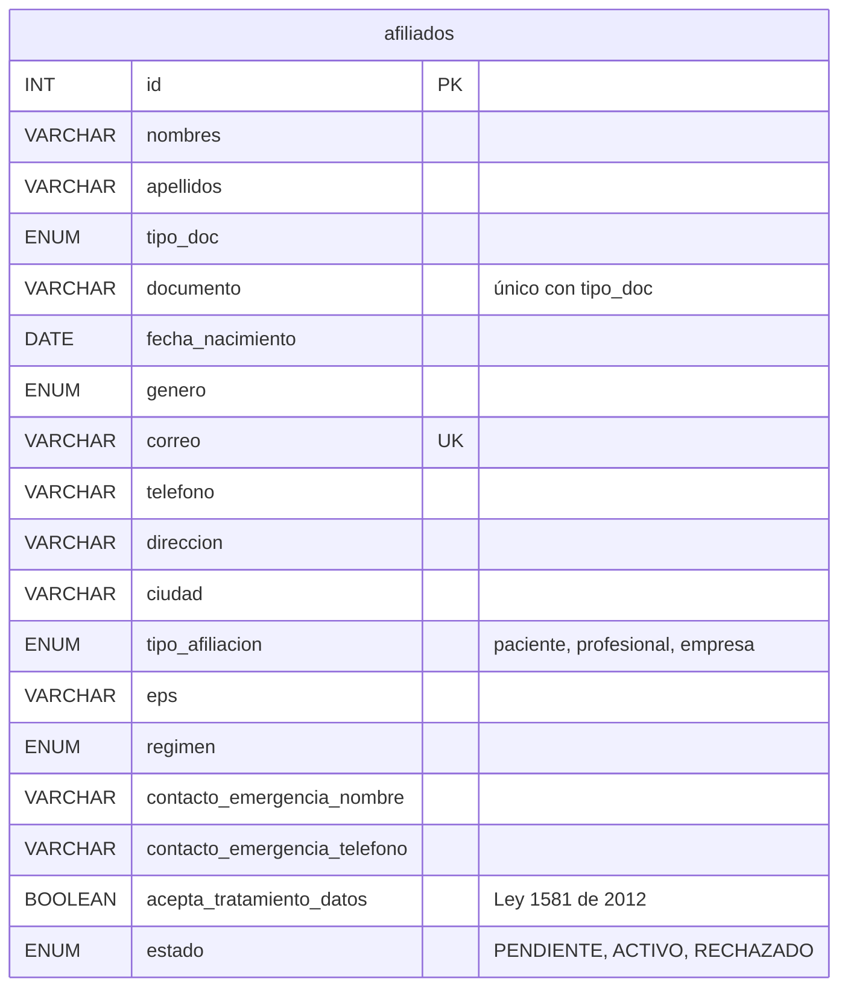
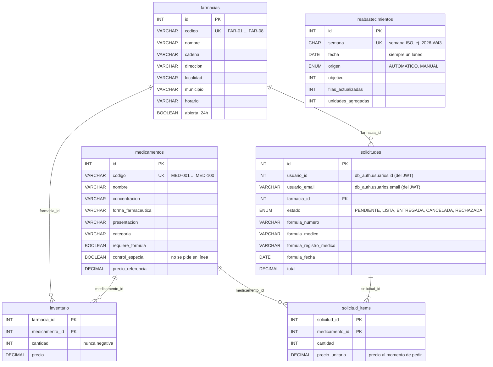
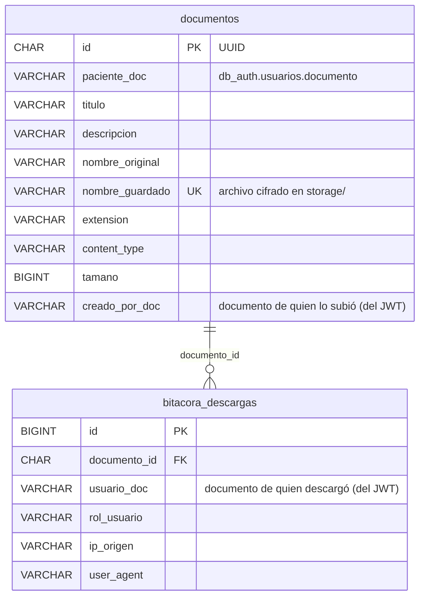
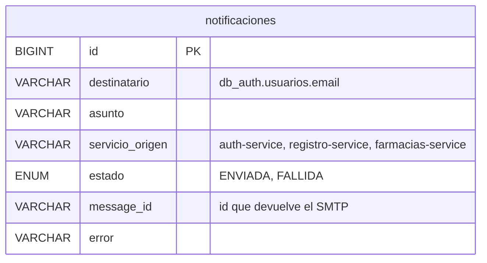
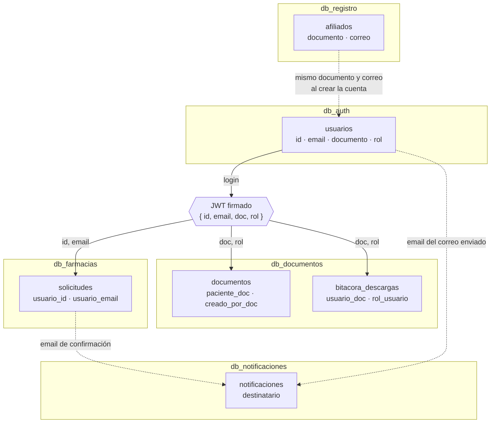

# Arquitectura de datos de Tecnosalud Católica

Este documento explica **qué guarda cada microservicio, en qué base de datos y cómo se relacionan los datos entre servicios**. Todas las bases viven en el mismo servidor de **Azure Database for MySQL** (`tecnosalud-mysql.mysql.database.azure.com`, región Mexico Central). Se crean con un solo comando:

```bash
cd backend
npm run db:init            # las cinco bases
npm run db:init -- farmacias   # solo una (auth, registro, farmacias, documentos, notificaciones)
```

Para verlas en Azure: servidor `tecnosalud-mysql` → **Settings → Databases**.

---

## 1. Principio: una base de datos por microservicio

Cada microservicio es **dueño exclusivo** de su base de datos. Ningún servicio lee ni escribe en la base de otro.

| Microservicio | Puerto | Base de datos | Qué guarda |
|---|---|---|---|
| `auth-service` | 3002 | `db_auth` | Usuarios, roles, contraseñas (bcrypt), tokens de recuperación, bitácora de accesos |
| `registro-service` | 3003 | `db_registro` | Solicitudes de afiliación |
| `farmacias-service` | 3004 | `db_farmacias` | Catálogo de medicamentos, farmacias, inventario, pedidos y reabastecimientos |
| `notification-service` | 3005 | `db_notificaciones` | Historial de correos enviados |
| `documentos-service` | 3006 | `db_documentos` | Metadatos de documentos clínicos y bitácora de descargas (los archivos van cifrados en disco) |

**¿Por qué así?** Si un servicio cambia sus tablas, se cae o se reemplaza, los demás siguen funcionando. Es el patrón *database per service* de las arquitecturas de microservicios. Por eso **no hay llaves foráneas entre bases distintas**: las relaciones entre servicios se hacen con identificadores que viajan en el JWT o en las llamadas entre servicios (sección 3).



---

## 2. Tablas de cada base de datos

### 2.1 `db_auth` (auth-service)



- **`usuarios`**: un usuario por correo y por documento. La contraseña nunca se guarda, solo su hash bcrypt.
- **`bitacora_acceso`**: cada intento de login, exitoso o no, con motivo e IP.
- **`intentos_fallidos` / `bloqueado_hasta`**: tras 5 contraseñas incorrectas seguidas la cuenta se bloquea 15 minutos. Un login exitoso o restablecer la contraseña la desbloquean.
- Usuarios nuevos: `npm run usuario:crear` (ver README).

### 2.2 `db_registro` (registro-service)



Guarda las solicitudes de afiliación del formulario **Registro**. Una afiliación **no crea automáticamente un usuario**: cuando se aprueba, un administrador crea la cuenta con `npm run usuario:crear` usando el mismo correo y documento (sección 3).

### 2.3 `db_farmacias` (farmacias-service)



- **Pedido**: se descuentan las unidades de `inventario` en una transacción con `SELECT … FOR UPDATE`, así dos pedidos simultáneos no pueden llevarse la misma unidad. Cancelar devuelve las unidades.
- **Reabastecimiento**: cada lunes (hora de Bogotá) los productos con menos de 60 unidades vuelven a 60. `semana` es única, así que solo ocurre una vez por semana.
- `precio_unitario` guarda el precio del momento: si después cambia el precio, el pedido conserva el original.

### 2.4 `db_documentos` (documentos-service)



La base guarda solo los **metadatos**. El archivo está en `backend/services/documentos-service/storage/`, cifrado con AES-256-GCM (`DOCUMENTOS_ENCRYPTION_KEY`).

### 2.5 `db_notificaciones` (notification-service)



No guarda el cuerpo del correo, para no almacenar enlaces de recuperación ni datos clínicos.

---

## 3. Cómo se relacionan los datos entre servicios

Al iniciar sesión, `auth-service` firma un **JWT** con los datos del usuario. Los demás servicios **validan la firma** con el mismo `JWT_SECRET` y usan esos datos como identidad, sin consultar `db_auth`. Esa es la unión entre bases:



| Dato en otra base | Se relaciona con `db_auth.usuarios` por | Cómo llega |
|---|---|---|
| `db_farmacias.solicitudes.usuario_id` | `usuarios.id` | Campo `id` del JWT al hacer el pedido |
| `db_farmacias.solicitudes.usuario_email` | `usuarios.email` | Campo `email` del JWT (para el correo de confirmación) |
| `db_documentos.documentos.paciente_doc` | `usuarios.documento` | Campo `doc` del JWT; un paciente solo ve los suyos |
| `db_documentos.documentos.creado_por_doc` y `bitacora_descargas.usuario_doc` | `usuarios.documento` | Campo `doc` del JWT de quien sube o descarga |
| Permisos de documentos (`MEDICO`, `ADMIN`) | `roles.nombre` | Campo `rol` del JWT |
| `db_notificaciones.notificaciones.destinatario` | `usuarios.email` | El servicio que pide el correo envía el destinatario |
| `db_registro.afiliados.documento` y `correo` | `usuarios.documento` y `email` | Al aprobar la afiliación se crea el usuario con los mismos datos (`npm run usuario:crear`) |

**Consecuencias de diseño:**
- Si un usuario cambia de correo en `db_auth`, los pedidos antiguos conservan el correo con el que se hicieron. Es intencional: es el historial de lo que pasó.
- Los servicios confían en el JWT durante sus 8 horas de vigencia. Para revocar el acceso antes, hay que desactivar el usuario y esperar a que expire el token.
- Para unir datos de varias bases (por ejemplo, un reporte "pedidos por nombre de usuario"), se consulta cada servicio y se cruza por `id`, `email` o `documento`. Nunca se hace un `JOIN` entre bases desde un microservicio.

---

## 4. Flujos completos

### 4.1 Iniciar sesión
1. El navegador envía correo y contraseña a `auth-service`.
2. `auth-service` busca en `db_auth.usuarios`, revisa `bloqueado_hasta` y compara el hash bcrypt.
3. Registra el intento en `bitacora_acceso` y actualiza `intentos_fallidos`.
4. Pide a `notification-service` el correo de alerta, que queda en `db_notificaciones`.
5. Devuelve el JWT `{ id, email, doc, rol }`, que el navegador guarda para los demás servicios.

### 4.2 Pedir medicamentos
1. El usuario consulta el catálogo y en qué farmacias hay cada medicamento (`db_farmacias.inventario`).
2. Arma el carrito y envía el pedido con su JWT.
3. `farmacias-service` valida la fórmula si hace falta, bloquea las filas de inventario, descuenta las unidades y crea `solicitudes` + `solicitud_items` en una sola transacción.
4. Pide a `notification-service` el correo de confirmación (queda en `db_notificaciones`).
5. Los lunes, el reabastecimiento devuelve el inventario a 60 unidades por producto (`reabastecimientos`).

### 4.3 Documentos clínicos
1. El usuario sube un PDF o imagen con su JWT.
2. `documentos-service` verifica que el `doc` del JWT sea el del paciente (o que el rol sea `MEDICO`/`ADMIN`), cifra el archivo en `storage/` y guarda los metadatos en `db_documentos.documentos`.
3. Al descargar, confirma la identificación, descifra el archivo y registra la descarga en `bitacora_descargas`.

### 4.4 Recuperar contraseña
1. `auth-service` crea un token aleatorio en `tokens_recuperacion` (15 minutos) y pide el correo con el enlace.
2. Al usar el enlace, valida el token, guarda el nuevo hash, marca el token como usado y desbloquea la cuenta.

---

## 5. Seguridad de los datos

- **Conexión cifrada** con Azure (`DB_SSL=true`, TLS 1.2) y firewall por IP.
- **Contraseñas** con bcrypt. **Documentos** cifrados con AES-256-GCM. **Correos** sin cuerpo en el historial.
- **Consultas parametrizadas** (`?`) en todos los servicios para evitar inyección SQL.
- **Credenciales** solo en los `.env` de cada servicio, que nunca se suben a git (ver los `.env.example`).
- **Auditoría**: `bitacora_acceso` (logins), `bitacora_descargas` (documentos), `notificaciones` (correos) y `reabastecimientos` (inventario).
